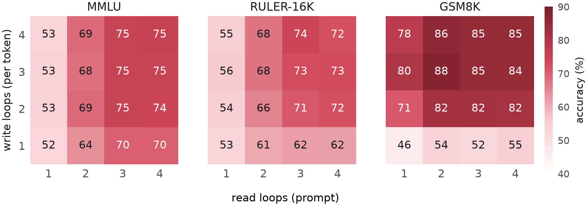
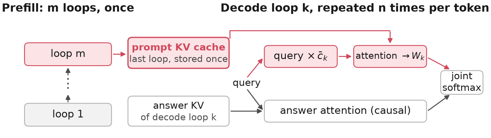
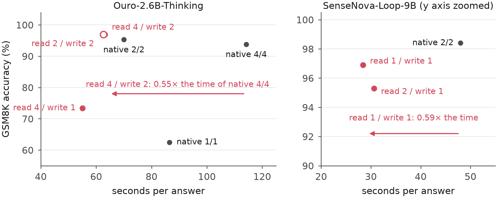
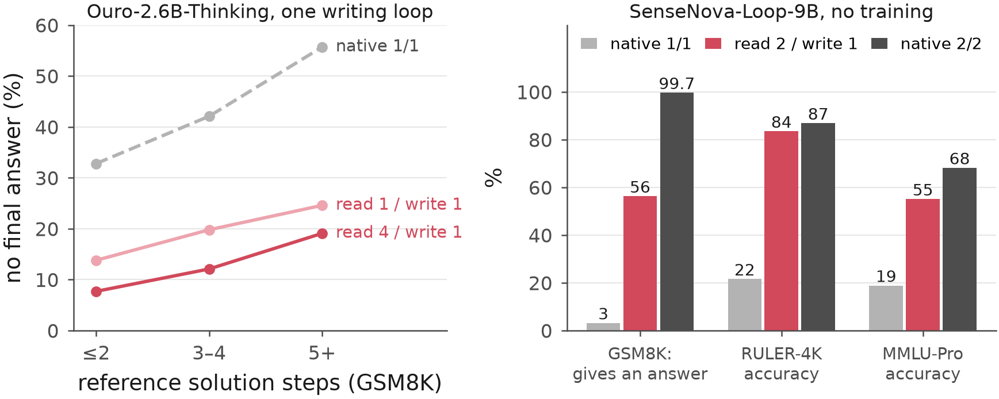
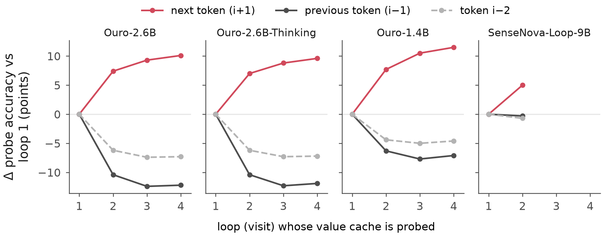

# Read Deep, Write Shallow: How Looped Language Models Should Spend Their Depth

**Paper:** [`paper/read-deep-write-shallow.pdf`](paper/read-deep-write-shallow.pdf) (arXiv link coming) · **Author:** Yang Hu ·
**Code license:** MIT · **Keywords:** looped language model, recurrent depth, universal transformer, Ouro, SenseNova-Loop,
test-time compute, prefill vs decode depth, KV cache, KV sharing, RoPE, depth allocation, efficient reasoning

Looped (recurrent-depth) language models run one block of layers several times per token, and they usually spend the
same number of loops reading the prompt (prefill) and writing the answer (decode). This repository measures what each
kind of depth buys. A small **depth-split connector** (LoRA plus per-loop key–value maps on a frozen model) lets a looped
model read the prompt with *p* loops and write the answer with *d* loops; one set of its parameters serves all 16 pairs
up to four loops.

**Every number in the paper is recomputed from released per-item scores by one script:**
`python ouro/scripts/paper_numbers.py compute` (numpy only, seconds on a laptop). See [`REPRODUCE.md`](REPRODUCE.md).

## Key findings

1. **Reading depth and writing depth buy different things.** On Ouro-2.6B, with one connector evaluated at all 16
   (read, write) pairs, knowledge (MMLU) and long-context accuracy (RULER-16K) change mainly along the read axis and
   multi-step derivation (GSM8K) mainly along the write axis. At one writing loop, reading 4 loops instead of 1 adds
   **+15.2 MMLU** [14.3, 16.1] and **+8.6 RULER-16K** [4.3, 12.8] within the same connector (full test sets, paired
   bootstrap 95% intervals); a second training seed gives +15.2 and +8.6 again.
2. **With the writer fixed, reading deeper helps on five checkpoints from two families** (Ouro-2.6B, Ouro-1.4B,
   Ouro-2.6B-Thinking, Ouro-1.4B-Thinking, SenseNova-Loop-9B), e.g. MMLU-Pro +18.6 [13.6, 23.8] on Ouro-2.6B-Thinking.
   **Not everywhere:** on HELMET (averaged per category, as its authors do) reading deep helps retrieval-augmented QA,
   re-ranking and in-context learning on Ouro but loses exact key-value recall, so read 4 / write 2 scores below native
   4/4 on the HELMET average (-8.7 [-13.3, -4.1]); it also lowers 4-shot MATH, and both 1.4B models collapse on few-shot
   BBH at read 4 / write 1.
3. **Writing shallow is where time is saved.** Writing is paid per token. On Ouro-2.6B-Thinking a connector writing with
   2 loops answers GSM8K in **0.55×** [0.45, 0.67] the time of the 4-loop model (batch 1, prefill included), and on all
   1,319 problems it is 1.0 point below it (93.3 vs 94.2, paired [−2.0, +0.1]). Reading 2 or 4 loops before writing gives
   the same time (1.01× [0.90, 1.11]): the saving comes from the shallower adapted writer. On SenseNova-Loop-9B a one-loop
   writer scores 95.6 vs 95.8 for the two-loop model at **0.59×** the time.
4. **Reading deeper helps a one-loop writer finish.** On Ouro-2.6B-Thinking the share of GSM8K answers without a boxed
   answer falls from 19.5% (read 1 / write 1) to 12.7% (read 4 / write 1) in every difficulty bucket. On
   SenseNova-Loop-9B, handing the native one-loop writer a two-visit prompt state, with no training at all, lifts RULER-4K
   from 21.6 to 83.5 and MMLU-Pro from 18.9 to 55.1 (GSM8K accuracy only from 2.2 to 10.9).
5. **One KV cache serves every loop exactly.** A per-frequency complex key scale commutes with RoPE, so it can be folded
   into the query; with a post-attention value map, one stored prompt cache serves every writing loop (512/512 greedy
   tokens identical to materialised per-loop caches). Restricting the key map this way costs nothing measurable.
6. **Later loops make the next token more decodable.** Linear probes on the value cache (same weights, same layer): from
   loop 1 to 4 of Ouro-2.6B the next token becomes more linearly decodable (26.0 → 36.1%) and the previous token less
   (57.7 → 45.5%); SenseNova shows the next-token gain only. Reading deep is worse for short-context retrieval
   (RULER-4K −3.8, inconclusive) and 4-shot MATH (−11.2), but zero-shot MATH improves (+7.0).











## When to use it, and when not

- Read deep for knowledge and long-context reading; write shallow when answers are long and latency matters.
- Gains against native models include the adaptation of the connector; read-depth effects are measured within one
  connector (read p / write d vs read d / write d) or without training (SenseNova).
- For short verbatim retrieval or few-shot prompts that must be imitated, read fewer loops.
- At three or more writing loops, a single deep prompt bank trails the native model on retrieval (RULER-4K −10.4 at write 3).
- 1.4B models collapse at read 4 / write 1 on few-shot CoT BBH.
- Sharing one answer bank across loops more than doubles long-answer throughput at write 4 but costs 4.8 GSM8K points
  against native 4/4.

## Repository map

| path | what |
|---|---|
| `REPRODUCE.md` | every table and figure → script → result file; training and evaluation commands |
| `ouro/scripts/paper_numbers.py`, `ouro/results/items/` | per-item scores of every run the paper uses; recomputes every number |
| `ouro/model.py`, `ouro/adapter_model.py`, `ouro/batched.py`, `ouro/train_batched.py` | frozen Ouro backbone, depth-split connector, batched KL distillation from the native model |
| `ouro/single_bank.py`, `ouro/bench_throughput.py` | exact single-bank decoding (two flash-attention calls merged by log-sum-exp), native baselines, throughput |
| `ouro/evaluate_bench.py`, `ouro/lmeval_ouro.py`, `ouro/run_lmeval.py`, `ouro/lmeval_tasks/` | evaluation (RULER, HELMET; lm-evaluation-harness wrapper and zero-shot thinking tasks) |
| `ouro/sensenova_runner.py`, `ouro/sensenova_bridge.py` | SenseNova-Loop-9B (hybrid Gated-DeltaNet) runner, state splicing and connector |
| `ouro/scripts/` | end-to-end latency, probes, figures |
| `ouro/runs_scripts/` | the launchers used for every run |
| `third_party/ouro/` | Ouro modeling code (Apache-2.0, see its LICENSE) |
| `paper/` | PDF, LaTeX source, figures, arXiv build script |

## Citation

```bibtex
@misc{hu2026readdeep,
  title  = {Read Deep, Write Shallow: How Looped Language Models Should Spend Their Depth},
  author = {Hu, Yang},
  year   = {2026},
  note   = {https://github.com/yanghu819/read-deep-write-shallow}
}
```
