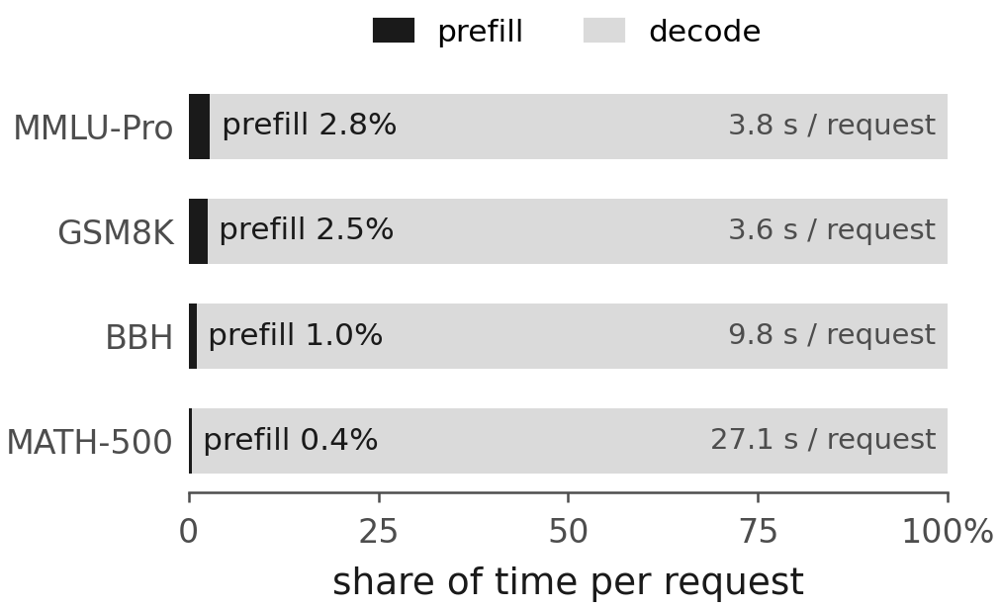
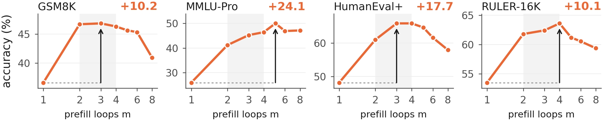
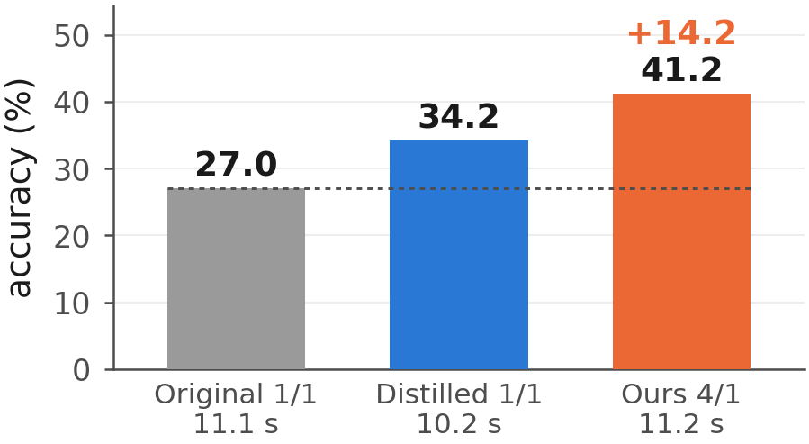

# Untying Prefill and Decode Loops in Looped Language Models

**Paper:** [`paper/untying-prefill-decode-loops.pdf`](paper/untying-prefill-decode-loops.pdf) (arXiv link coming) ·
**Author:** Yang Hu · **Code license:** MIT · **Keywords:** looped language model, recurrent depth, Ouro, test-time
compute, prefill vs decode, loop adapter, KV cache

Looped (recurrent-depth) language models run one block of layers several times per token, with the same number of
loops for reading the prompt (prefill) and for every answer token (decode). Generation is almost all decoding, so we
ask whether the loops are better spent on the prompt. **LoopBridge**, a small adapter (LoRA plus per-loop key-value maps
on a frozen model), lets a decoder with *n* loops read the prompt states of any prefill depth *m*; we measure where inference
time goes, how accuracy changes as *m* grows from 1 to 16 at a fixed *n*, and how more prefill loops compare at equal
measured time with the original model, distilled models and more decode loops.

**Every number in the paper is recomputed from released per-item scores and timing records by one script** and checked
against the printed value: `python ouro/scripts/paper_numbers.py compute`. See [`REPRODUCE.md`](REPRODUCE.md).

## Key findings (Ouro-2.6B unless stated)

1. **Generation is almost all decoding.** Prefill is 0.1-3% of the time of a chain-of-thought answer.
2. **More prefill loops help at a fixed decode depth, then level off.** With the same weights, four prefill loops instead of
   one raise the 11-benchmark average from 47.2 to 56.8 at one decode loop (gain 9.0 +- 0.6 over three seeds). On
   most benchmarks the gain stops at two to four loops, also for an adapter trained up to 16 loops, on
   Ouro-2.6B-Thinking and on Ouro-1.4B.
3. **At equal measured time** (maps folded into the prompt cache, two clean timing passes), Ours 4/1 beats the original
   model at one loop by 14.2 points and a distilled one-loop model by 7.0 at about the same time per request; a second
   decode loop buys 15.5 more points for 1.4x the time; at two decode loops more prefill loops and distillation tie.
4. **The baselines are not under-tuned:** the distilled controls move by at most 0.6 points over a 0.3x-3x learning-rate
   range and at rank 80, and the adapter's weakest learning rate still beats the best distilled control.
5. **Exceptions:** 4-shot MATH-500 (one prefill loop is best; without exemplars four are better) and exact recall in
   HELMET.







## When to use it, and when not

- Use more prefill loops when decoding must stay at one loop; with more time, a second decode loop buys more
  on long chain-of-thought answers.
- Two to four prefill loops are enough on most tasks; more can hurt. The best count depends on the prompt format (on
  few-shot MATH-500 one prefill loop is best). It is not a per-prompt router.

## Repository map

| path | what |
|---|---|
| `REPRODUCE.md` | every table and figure → script → result file; training and evaluation commands |
| `ouro/scripts/paper_numbers.py`, `ouro/results/items/` | per-item scores of every run the paper uses; recomputes every number |
| `ouro/model.py`, `ouro/adapter_model.py`, `ouro/batched.py`, `ouro/train_batched.py` | frozen Ouro backbone, loop adapter, batched KL distillation from the native model |
| `ouro/single_bank.py`, `ouro/bench_throughput.py` | exact single-bank decoding (two flash-attention calls merged by log-sum-exp), native baselines, throughput |
| `ouro/evaluate_bench.py`, `ouro/lmeval_ouro.py`, `ouro/run_lmeval.py`, `ouro/lmeval_tasks/` | evaluation (RULER, HELMET; lm-evaluation-harness wrapper and zero-shot thinking tasks) |
| `ouro/sensenova_runner.py`, `ouro/sensenova_bridge.py` | SenseNova-Loop-9B (hybrid Gated-DeltaNet) runner, state splicing and loop adapter |
| `ouro/scripts/` | paper numbers, figures, end-to-end latency |
| `ouro/runs_scripts/` | the launchers used for every run |
| `third_party/ouro/` | Ouro modeling code (Apache-2.0, see its LICENSE) |
| `paper/` | PDF, LaTeX source, figures, arXiv build script; `HANDOFF.md` / `NOTES.md` are the working log |

## Citation

```bibtex
@misc{hu2026untying,
  title  = {Untying Prefill and Decode Loops in Looped Language Models},
  author = {Hu, Yang},
  year   = {2026},
  note   = {https://github.com/yanghu819/untying-prefill-decode}
}
```
