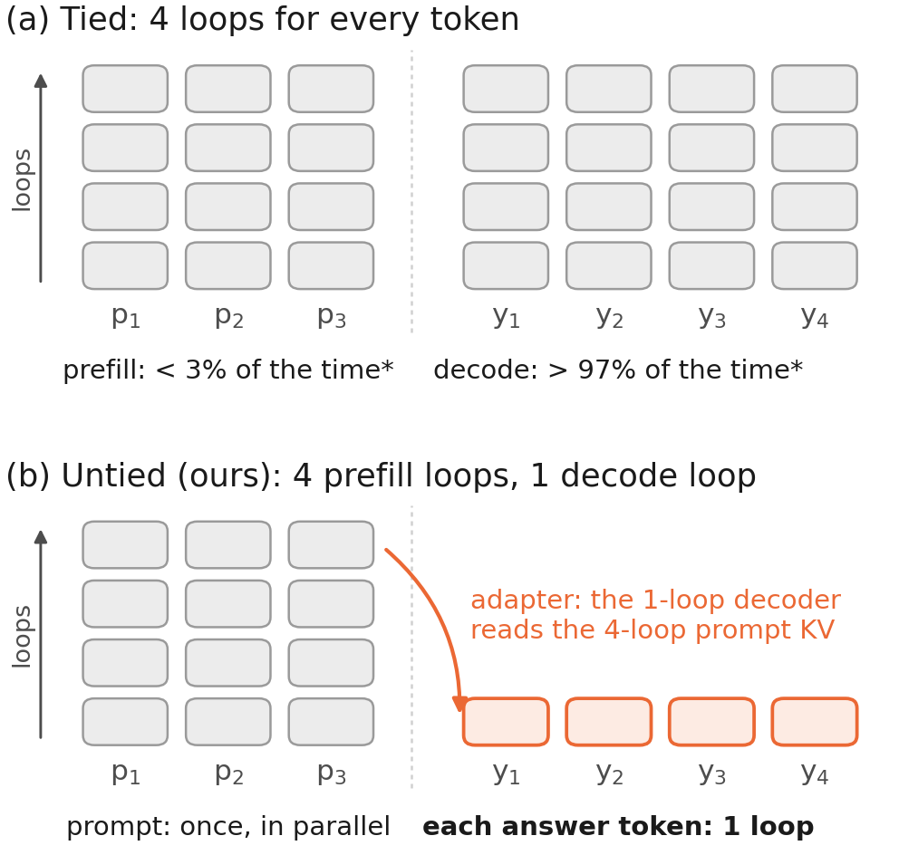

# Untying Prefill and Decode Loops in Looped Language Models

**Paper:** [`paper/untying-prefill-decode-loops.pdf`](paper/untying-prefill-decode-loops.pdf) (arXiv link coming) ·
**Author:** Yang Hu · **Code license:** MIT · **Keywords:** looped language model, recurrent depth, Ouro, test-time
compute, prefill vs decode, loop adapter, KV cache

Looped (recurrent-depth) language models run one block of layers several times per token, with the same number of
loops for reading the prompt (prefill) and for every answer token (decode). Generation is almost all decoding, so we
**untie the two loop counts**: read the prompt with *m* loops and decode each answer token with fewer, *n < m*. The
released model cannot do this by itself, so we distill a small adapter (2.4% of the parameters): **LoRA on the
decoder** when the prefill depth is fixed ("Ours, fixed m"), or **LoopBridge** (LoRA plus per-loop key/value maps on
the prompt cache), which serves every (m, n) with one set of weights ("Ours, any m").

**Every number in the paper is recomputed from released per-item scores and timing records by one script** and checked
against the printed value: `python ouro/scripts/paper_numbers.py compute`. See [`REPRODUCE.md`](REPRODUCE.md).

## Key findings (Ouro-2.6B unless stated)

1. **Generation is almost all decoding.** Prefill is 0.4-2.8% of the time of a chain-of-thought answer.
2. **Same decode loops, more accuracy.** With one decode loop, four prefill loops raise the 11-benchmark average from
   44.2 (original model) to 57.1 (fixed-depth adapter) and 56.8 (LoopBridge), above the original model distilled to
   one loop on the same data (49.8; 50.2 at rank 80); with two decode loops, 63.0 -> 67.3 / 67.2.
3. **Same measured time, more accuracy.** At one decode loop and about 11 s per request, +15.0 and +14.2 points over
   the original model and +7.8 and +7.0 over the distilled one (paired over 400 requests). Served with continuous
   batching at batch 32, LoopBridge 4/1 keeps +14.5 / +8.0 points for 1.15x / 1.16x their time per request.
4. **A few prefill loops suffice.** The gain peaks after two to five prefill loops (also for an adapter trained up to
   16 loops, over seeds, and when the prefill loops are trained too).
5. **It transfers** to Ouro-1.4B, Ouro-2.6B-Thinking (prefill 4 / decode 2 within 1.3 points of the original 4/4 on average;
   served in batches of 16-32, as accurate as 4/4 on GSM8K, 96.5 vs 95.5, in 0.46-0.56x its time; on MATH-500 between 2/2 and 4/4 in 0.58x the time of 4/4) and looped decision
   models (Lev, +4.4 to +7.5 at one decision loop).
6. **LoopBridge's key/value maps keep retrieval over 16K-token prompts** when one adapter serves every depth
   (RULER-16K at 4/1 over three seeds: 63.9 vs 57.6 for a parameter-matched rank-80 LoRA and 44.7 at rank 16); they
   do not help HELMET or LongBench.
7. **The baselines are not under-tuned:** the distilled controls move by at most 0.6 points over a 0.3x-3x
   learning-rate range and at rank 80; LoopBridge's weakest learning rate still beats the best distilled control.




## When to use it, and when not

- Use more prefill loops when decoding must stay at one loop; with more time, a second decode loop buys more
  on long chain-of-thought answers.
- Two to four prefill loops are enough on most tasks; more can hurt. The best count depends on the prompt format (on
  few-shot MATH-500 one prefill loop is best). It is not a per-prompt router.

## Repository map

| path | what |
|---|---|
| `REPRODUCE.md` | every table and figure → script → result file; training and evaluation commands |
| `ouro/scripts/paper_numbers.py`, `ouro/results/items/` | per-item scores of every run the paper uses; recomputes every number |
| `ouro/model.py`, `ouro/adapter_model.py`, `ouro/batched.py`, `ouro/train_batched.py` | frozen Ouro backbone, loop adapter, batched KL distillation from the native model |
| `ouro/single_bank.py`, `ouro/bench_throughput.py` | exact single-bank decoding (two flash-attention calls merged by log-sum-exp), native baselines, throughput |
| `ouro/evaluate_bench.py`, `ouro/lmeval_ouro.py`, `ouro/run_lmeval.py`, `ouro/lmeval_tasks/` | evaluation (RULER, HELMET; lm-evaluation-harness wrapper and zero-shot thinking tasks) |
| `ouro/sensenova_runner.py`, `ouro/sensenova_bridge.py` | SenseNova-Loop-9B (hybrid Gated-DeltaNet) runner, state splicing and loop adapter |
| `ouro/scripts/` | paper numbers, figures, end-to-end latency |
| `ouro/runs_scripts/` | the launchers used for every run |
| `third_party/ouro/` | Ouro modeling code (Apache-2.0, see its LICENSE) |
| `paper/` | PDF, LaTeX source, figures, arXiv build script; `HANDOFF.md` / `NOTES.md` are the working log |

## Citation

```bibtex
@misc{hu2026untying,
  title  = {Untying Prefill and Decode Loops in Looped Language Models},
  author = {Hu, Yang},
  year   = {2026},
  note   = {https://github.com/yanghu819/untying-prefill-decode}
}
```
