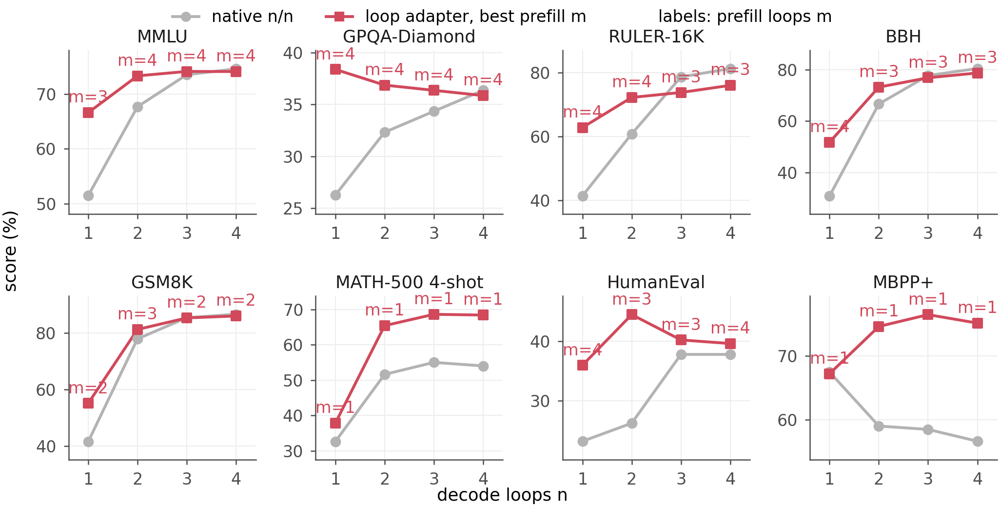
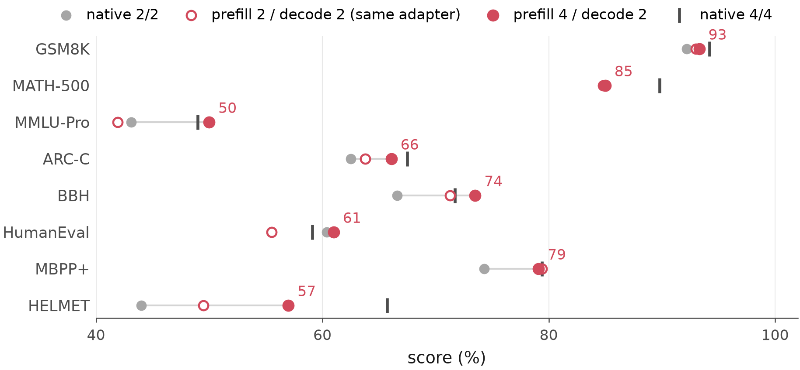
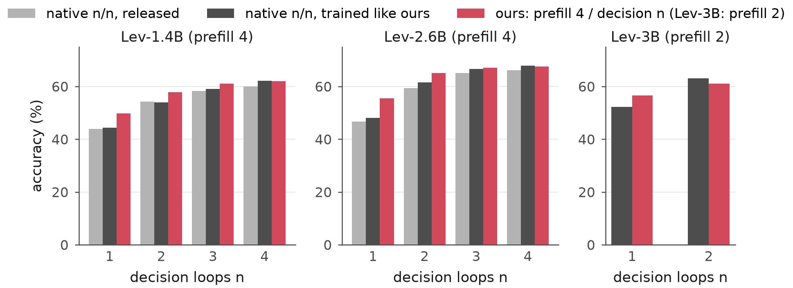

# Untying Prefill and Decode Loops in Looped Language Models

**Paper:** [`paper/untying-prefill-decode-loops.pdf`](paper/untying-prefill-decode-loops.pdf) (arXiv link coming) ·
**Author:** Yang Hu · **Code license:** MIT · **Keywords:** looped language model, recurrent depth, universal
transformer, Ouro, SenseNova-Loop, Lev, test-time compute, prefill vs decode, loop adapter, KV cache, RoPE

Looped (recurrent-depth) language models run one block of layers several times per token and, at inference, run the
same number of loops when they prefill the prompt and when they decode each answer token. This repository unties the
two. A small **loop adapter** (LoRA plus per-loop key–value maps on a frozen model) lets a looped model prefill with *m*
loops and decode with *n*; one set of its parameters serves all 16 pairs up to four loops, and one stored prompt KV
cache serves every decode loop.

**The paper's statistics are recomputed from released per-item scores by one script** and checked against the printed
values: `python ouro/scripts/paper_numbers.py compute` (numpy only). See [`REPRODUCE.md`](REPRODUCE.md) for what it covers.

## Key findings

1. **The best prefill count depends on the benchmark.** One loop adapter on Ouro-2.6B, evaluated at all 16 (prefill
   *m*, decode *n*) pairs on 13 benchmark settings (the *task map*, Figure 1). Within the same adapter, prefilling 4-shot
   MATH-500 with one loop instead of four raises accuracy from 51.8 to 68.4 at four decode loops (+16.6 [12.4, 21.0]);
   MMLU instead needs three or four prefill loops; GSM8K peaks with two and HumanEval with three or four.
2. **Choosing *m* per benchmark pays most when decoding is cheap.** Choosing *m* on one half of each benchmark's items
   and scoring it on the other half beats native Ouro-2.6B with the same number of decode loops significantly on
   **11 of 13** settings with one decode loop (+5 to +21 points) and **9 of 13** with two (intervals that repeat the
   choice of *m*); against the same adapter's own *n/n* it wins on 6 and 3 and never loses significantly. Ouro-1.4B, on the same 13 settings: 10 and 2 of 13. With three or
   four decode loops the native model is about as good, except on long-context retrieval where it is better.
3. **Beyond a distillation baseline.** On Ouro-2.6B-Thinking, prefill 4 / decode 2 has higher point estimates than
   native 2/2 on eight benchmarks (significantly on five) and scores above a LoRA distillation of native 2/2 trained
   with the same data, teacher and tokens (significantly on MMLU-Pro +5.2 and ARC-C +2.9).
4. **The adapted two-loop decoder is faster end to end.** On 64 timed GSM8K problems (batch 1, prefill included)
   prefill 4 / decode 2 answers in **0.55×** [0.45, 0.67] the time of native 4/4 (the same adapter at 2/2 is as fast);
   on all 1,319 problems it is 1.0 point below it.
5. **Looped decision models (Lev), both directions.** With more prefill than decision loops, Lev models are
   significantly above a matched-data and matched-update control on 12 of 13 (*m*, *n*) pairs (+4.4 to +7.5 at one
   decision loop on three backbones); with fewer, they are below it on all 13 (significantly on 11).
6. **One KV cache serves every loop exactly.** A per-frequency complex key scale commutes with RoPE, so it can be
   applied to the query; with a post-attention value map, one stored prompt cache serves every decode loop.









## When to use it, and when not

- Choose the prefill count per benchmark (or task family) on a small labeled set; it matters most with one or two
  decode loops. It is not a per-prompt router and the choice need not transfer to unseen tasks.
- The best count depends on the prompt format (few-shot vs zero-shot) and the checkpoint.
- Comparisons with native models include training the adapter; within-adapter comparisons isolate the prefill loops.
- More prefill loops raise time to first token; equal decode loops do not mean equal latency.

## Repository map

| path | what |
|---|---|
| `REPRODUCE.md` | every table and figure → script → result file; training and evaluation commands |
| `ouro/scripts/paper_numbers.py`, `ouro/results/items/` | per-item scores of every run the paper uses; recomputes every number |
| `ouro/model.py`, `ouro/adapter_model.py`, `ouro/batched.py`, `ouro/train_batched.py` | frozen Ouro backbone, loop adapter, batched KL distillation from the native model |
| `ouro/single_bank.py`, `ouro/bench_throughput.py` | exact single-bank decoding (two flash-attention calls merged by log-sum-exp), native baselines, throughput |
| `ouro/evaluate_bench.py`, `ouro/lmeval_ouro.py`, `ouro/run_lmeval.py`, `ouro/lmeval_tasks/` | evaluation (RULER, HELMET; lm-evaluation-harness wrapper and zero-shot thinking tasks) |
| `ouro/sensenova_runner.py`, `ouro/sensenova_bridge.py` | SenseNova-Loop-9B (hybrid Gated-DeltaNet) runner, state splicing and loop adapter |
| `ouro/scripts/` | paper numbers, figures, end-to-end latency |
| `ouro/runs_scripts/` | the launchers used for every run |
| `third_party/ouro/` | Ouro modeling code (Apache-2.0, see its LICENSE) |
| `paper/` | PDF, LaTeX source, figures, arXiv build script |

## Citation

```bibtex
@misc{hu2026untying,
  title  = {Untying Prefill and Decode Loops in Looped Language Models},
  author = {Hu, Yang},
  year   = {2026},
  note   = {https://github.com/yanghu819/untying-prefill-decode}
}
```
